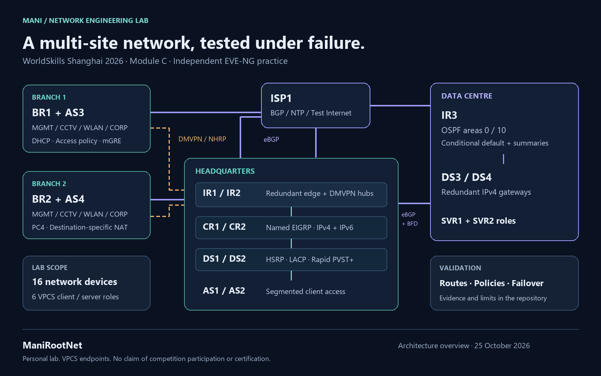

# Cisco Enterprise Networking | WorldSkills 2028 Preparation

**Mani Nazari · IT Network Systems Administration · Cisco portfolio**

I am preparing for **WorldSkills Aichi 2028**, with a focus on IT Network Systems Administration. This repository documents the Cisco networking part of that preparation through a working enterprise lab and selected validation evidence.

The technical reference is **Shanghai 2026, Module C**. I recreated its networking scenario in EVE-NG, connecting headquarters, a data centre and two branches through a simulated ISP.

**22 nodes · 4 sites · 36/36 verified access-policy checks · Dual-hub DMVPN**

## WorldSkills 2028 preparation

This project develops Cisco routing, switching, network services and practical verification skills. The published records connect the topology to protocol state and observed endpoint behavior, so another engineer can review the implementation.

| Preparation goal | Practice reference | Portfolio focus |
| --- | --- | --- |
| WorldSkills Aichi 2028 | Shanghai 2026 IT Network Systems Administration, Module C | Cisco enterprise networking in EVE-NG |

[WorldSkills Aichi 2028](https://worldskills.org/media/news/worldskills-japan-will-host-49th-worldskills-competition/) · [IT Network Systems Administration](https://worldskills.org/skills/id/212/)

## Engineering scope

| Layer | Design |
| --- | --- |
| Enterprise routing | Named EIGRP for IPv4/IPv6, multi-area OSPF, authenticated eBGP and iBGP |
| Route control | Aggregation, exact outbound prefix filters, MED preference and conditional default redistribution |
| Campus | Rapid PVST+, VLAN-based root placement, LACP, HSRP and STP protection |
| Branch overlay | Two DMVPN hubs with dynamic spoke-to-spoke NHRP shortcuts |
| Segmentation | Separate management, CCTV, wireless and corporate networks |
| IP services | DHCP reservations, NTP hierarchy, exit-specific PAT and destination-specific static NAT |

The environment has 15 managed Cisco devices, one ISP router and six VPCS endpoints representing four clients and two server roles.

## Selected validation results

| Test | Recorded result |
| --- | --- |
| Access policy | 36/36 expected allow/deny decisions across four client roles, three sites and three destinations |
| Alternate HQ–DC path | PC1 and PC4 each reached SVR1 with 5/5 replies after the direct link was disabled |
| Secondary Internet exit | WLAN traffic received 5/5 replies through the secondary exit; translations matched its NAT pool |
| Conditional NAT | PC4-to-SVR1 traffic used the exit-specific mapping; SVR2 traffic retained the separate policy |
| LACP member protection | PC1-to-SVR1 traffic received 5/5 replies with one failed member isolated by UDLD |
| DC gateway SVI tests | SVR1-to-PC1 traffic received 3/3 replies through the alternate gateway |
| BFD/BGP detection | A same-router timestamp comparison recorded a conservative 408 ms upper bound |
| Time and persistence | 15/15 managed clocks synchronized; 16/16 router/switch configurations saved and compared |

Explore the [validation report](docs/validation-report.md), [skills and evidence map](docs/skills-and-evidence.md) and [selected live console evidence](evidence/README.md).

## How to review this portfolio

1. Follow the original architecture diagram to identify the routing, switching and overlay layers.
2. Compare each selected result with its endpoint output and protocol state.
3. Inspect the machine-readable policy results and file-integrity manifest.

The [verification guide](docs/verification-guide.md) explains the collection method. The [EVE-NG workspace screenshot](assets/eve-topology.jpg) shows the implemented lab; the architecture graphic is a separate explanatory overview.

## Project record

| Item | Detail |
| --- | --- |
| Initial implementation | Mani Nazari |
| Preparation goal | WorldSkills Aichi 2028 — IT Network Systems Administration |
| Environment | EVE-NG on VMware, Cisco IOS routers and switches |
| Validation record | Live console review and controlled tests, 25 October 2026 |
| Reference | Locally supplied WSC2026 TP39 Module C practice material |

This repository presents selected implementation outcomes and operational evidence. Configurations, credentials, IOS images and the original question files remain outside the portfolio.

[GitHub profile](https://github.com/ManiRootNet) · [LinkedIn](https://www.linkedin.com/in/manirootnet/)
